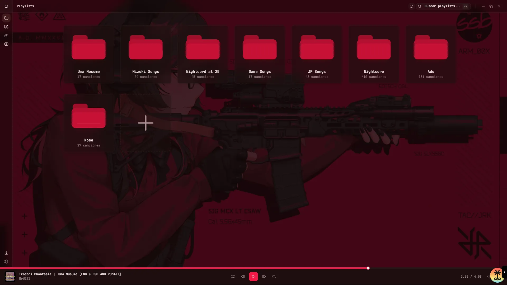
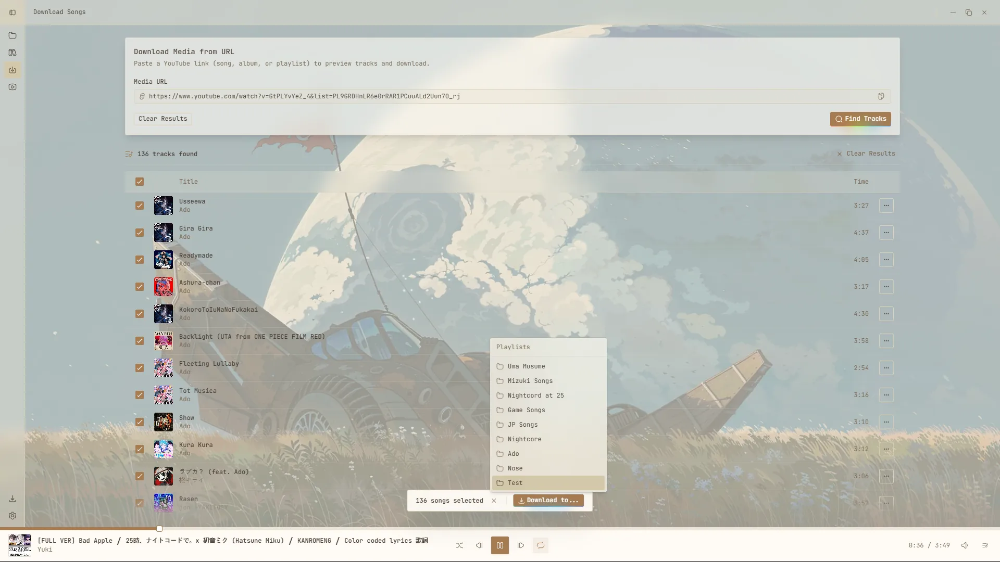
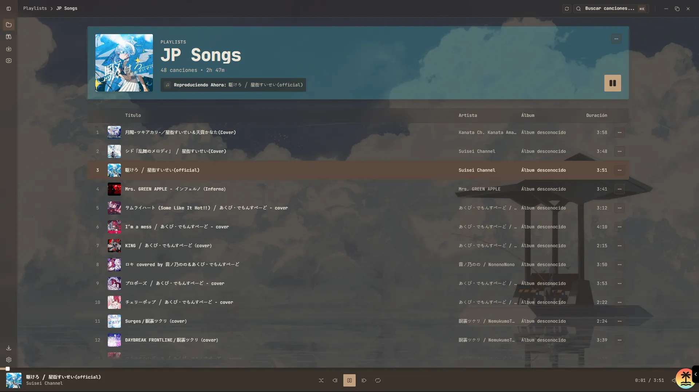

<div align="center">
  
  <h1>Ongaku (音楽)</h1>
  <p>Un reproductor de música de escritorio y descargador de YouTube ligero, minimalista y ultra rápido.</p>

  <p>
    <a href="https://github.com/miguedev1047/ongaku/releases"><b>Descargar Última Versión</b></a> •
    <a href="docs/es/bienvenida.md"><b>Documentación</b></a>
  </p>

  <p>
    <a href="README.md"><b>English</b></a> •
    <a href="README.es.md"><b>Español</b></a>
  </p>
</div>

---

## 📸 Capturas de Pantalla

<div align="center">
  
  <br/><br/>
  
  <br/><br/>
  
</div>

---

## 📥 Descargas

Obtén el instalador o ejecutable más reciente para tu plataforma directamente desde [GitHub Releases](https://github.com/miguedev1047/ongaku/releases):

- **Windows**: `ongaku_*_x64-setup.exe`
- **macOS**: `ongaku_*_x64.dmg` / `ongaku_*_aarch64.dmg`
- **Linux**: `ongaku_*_amd64.AppImage` / `ongaku_*_amd64.deb`

---

## 🌐 Sitio Web

La landing pública vive en [`apps/web`](apps/web) y se despliega en Cloudflare Workers con TanStack Start. Comparte la UI, configuración y assets de Ongaku desde `packages/`.

```bash
bun run dev:all      # App Tauri de escritorio + Web en :3000
bun run build:web    # Compila el sitio y sus dependencias del workspace
bun --filter web deploy
```

Consulta [`apps/web/README.md`](apps/web/README.md) para la configuración de Cloudflare y los secretos de CI.

---

## 📖 Documentación

Para ver la guía de instalación, solución de problemas, características completas y entorno de desarrollo:

- [Compatibilidad de Plataformas y Requisitos](docs/es/compatibilidad.md) _(Aviso de SmartScreen en Windows, aprobación de Gatekeeper en macOS, dependencias multimedia en Linux)_
- [Documentación Completa y Arquitectura](docs/es/bienvenida.md) _(Características detalladas, arquitectura técnica y configuración para desarrollo)_
- [Arquitectura de Seguridad y Defensa en Profundidad](docs/es/seguridad.md) _(Blindaje de `yt-dlp`, matriz de amenazas, pruebas en CI y reporte de vulnerabilidades)_
