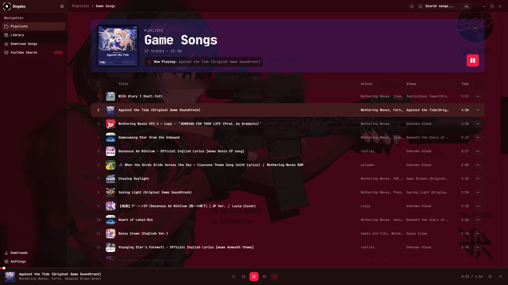

<div align="center">
  
  <h1>Ongaku (音楽)</h1>
  <p>A lightweight, minimal, and blazing-fast desktop music player and YouTube downloader.</p>

  <p>
    <a href="https://github.com/miguedev1047/ongaku/releases"><b>Download Latest Release</b></a> •
    <a href="docs/en/welcome.md"><b>Documentation</b></a>
  </p>

  <p>
    <a href="README.md"><b>English</b></a> •
    <a href="README.es.md"><b>Español</b></a>
  </p>
</div>

---

## 📸 Preview

<div align="center">
  
  <br/><br/>
  
  <br/><br/>
  
</div>

---

## 📥 Downloads

Get the latest installer or executable for your platform directly from [GitHub Releases](https://github.com/miguedev1047/ongaku/releases):

- **Windows**: `ongaku_*_x64-setup.exe`
- **macOS**: `ongaku_*_x64.dmg` / `ongaku_*_aarch64.dmg`
- **Linux**: `ongaku_*_amd64.AppImage` / `ongaku_*_amd64.deb`

---

## 🌐 Website

The public landing page lives in [`apps/web`](apps/web) and is deployed to Cloudflare Workers with TanStack Start. It shares the Ongaku UI, config and assets from `packages/`.

```bash
bun run dev:all      # Tauri desktop app + Web on :3000
bun run build:web    # Build the website and its workspace dependencies
bun --filter web deploy
```

See [`apps/web/README.md`](apps/web/README.md) for Cloudflare configuration and required CI secrets.

---

## 📖 Documentation

For detailed setup, troubleshooting, complete features, and developer guides:

- [Platform Compatibility & Requirements](docs/en/compatibility.md) _(Windows SmartScreen, macOS Gatekeeper approval, Linux multimedia dependencies)_
- [Complete Documentation & Architecture](docs/en/welcome.md) _(Key features, tech stack, and development setup)_
- [Security Architecture & Defense-in-Depth](docs/en/security.md) _(`yt-dlp` hardening, threat matrix, CI contract tests, and vulnerability reporting)_
